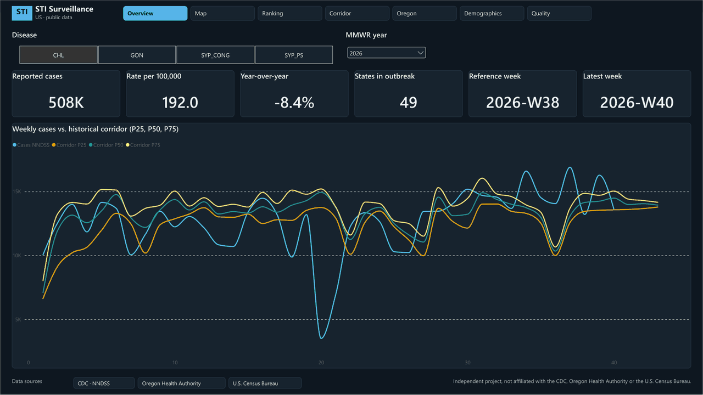
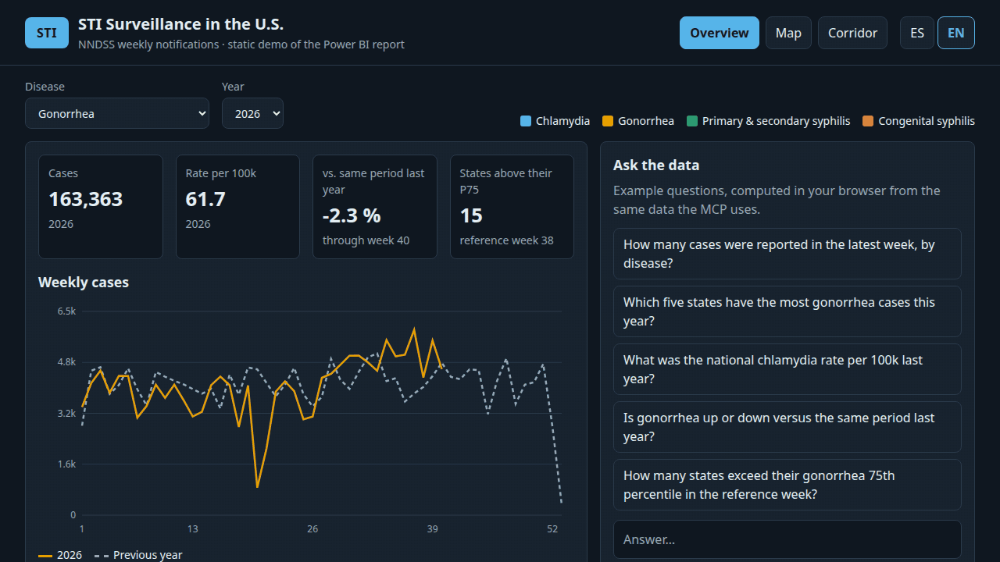

🇬🇧 [English](README.md) · 🇪🇸 [Español](README_es.md)

# sti-surveillance 🧬

**Can an AI assistant answer questions about STI surveillance data using the same governed model that feeds a Power BI report?**

This project builds both. A weekly pipeline brings CDC's national notifications (NNDSS) and Oregon's reportable-disease data (county, sex, age, race) into Postgres (Neon); dbt turns them into a star schema; and on top of that one model sit a **7-page Power BI report** with row- and object-level security, and a **read-only MCP server** so an AI can query the same tables and definitions without changing them or reading restricted columns. The public web demo is only an example of how this would work (see [Live demo](#live-demo-)).

Sources: [CDC NNDSS Weekly](https://data.cdc.gov/resource/x9gk-5huc), [Oregon Monthly Reportable Disease](https://data.oregon.gov/resource/rk77-sqhz) and [Census PEP 2025](https://www2.census.gov/programs-surveys/popest/datasets/2020-2025/state/totals/NST-EST2025-ALLDATA.csv). All free, no API key.

## Power BI report 📈

The main deliverable: seven pages (Overview, Map, Ranking, Corridor, Oregon, Demographics, Quality) over a single semantic model, with an accessible dark theme.



- **Composite model.** The two facts (`fct_nndss_weekly`, `fct_oregon_monthly`) stay in DirectQuery against Neon, five dimensions are Dual, and a small Import aggregation (`agg_weekly_national`) answers the national weekly views without touching the database.
- **Row-level security (RLS).** Each user sees only their rows: `dim_access` maps the sign-in (`USERPRINCIPALNAME()`) to a state or county, and the roles `State_Analyst`, `County_Analyst` and `Admin` filter `dim_geography` from it. An unknown user sees nothing.
- **Object-level security (OLS).** `Restricted_State_Analyst` and `Restricted_Epidemiologist` cannot see `race_group`, `age_group`, `demographic_level` or the `mart_revisions` table; the Demographics page says so instead of failing.
- **MCP.** The same model is also open to an AI assistant; see [MCP over the model](#mcp-over-the-model-).
- **Honest about gaps.** Rates are annualised per 100,000, masked cells stay empty, and the Oregon pages state the suppression rule (fewer than 6 cases).

## MCP over the model 🤖

The report answers the questions someone built a visual for; the MCP lets an AI answer the rest in plain language. It reads the model's definition (the TMDL, exposed as a resource) and queries the same star schema, so its figures use the report's definitions and match them (its totals equal an independent query for all five diseases). It is read-only, has a 10 s timeout, and its database role cannot read the restricted columns or the revision history. Examples: "Which five states have the most primary and secondary syphilis cases in 2025?", "Is California above its usual range for gonorrhea this week?". Details in [How it works](#how-it-works-%EF%B8%8F); to try a public version, see [Live demo](#live-demo-).

## Results 📊

- `dbt build`: 70 of 70 nodes pass.
- Cross-checks against the APIs: California gonorrhea in week 2024-W52 = 499 cases and Multnomah chlamydia in 2026-M01 = 294, both matching the source.
- The MCP view gives the same totals as an independent query for all five diseases.
- Ingestion is idempotent: two consecutive runs leave identical row counts.
- The weekly workflow runs green end to end (pytest, ingest, seed, snapshot, build, freshness) in about 1 min 17 s.
- Power BI model checked against SQL anchors: 12 table counts, NNDSS and Oregon totals, annualised rates (CA chlamydia 2024 = 259.434 per 100k), year-over-year in two forms (MMWR-aligned and `SAMEPERIODLASTYEAR`, which differ by exactly the 2,833 cases of week 2025-W1), the endemic corridor and the Oregon cuts (chlamydia 80,587 by county, 82,066 statewide).
- Aggregation hit confirmed three ways: Performance Analyzer, DAX Studio (`RewriteAttempted` with a match and a scan of `agg_weekly_national`, no SQL) and revoking `SELECT` on the fact from `pbi_reader`: the aggregated visual kept working and the other failed.
- Row-level security: the 10-case matrix in *View as* matches, and an unknown user sees nothing. Object-level security blocks `race_group`, `age_group`, `demographic_level` and `mart_revisions` in *View as* while `sex` keeps working.
- Report: 7 pages over one semantic model, with the accessible dark theme (contrast tests in `tests/test_theme_contrast.py`).
- MCP guardrails verified from Python: a valid query returns JSON, DML and restricted columns are blocked, and the database refuses writes and the `raw` schema on its own.

## Live demo 🌐

**[Live demo →](https://datakrdo.github.io/sti-surveillance/)** · [English](https://datakrdo.github.io/sti-surveillance/?lang=en) · [Español](https://datakrdo.github.io/sti-surveillance/?lang=es) · [Remote MCP](#live-demo-)

[](https://datakrdo.github.io/sti-surveillance/?lang=en)

An example of how this would work, public and free, with no online database or keys:

- **Static site** (GitHub Pages, `site/`): a 3-view replica of the report (Overview, Map, Corridor), with 5 example questions computed in the browser. `?tour=1` rotates the views automatically.
- **Read-only remote MCP** (Cloudflare Workers, `worker/`): 6 tools with validated parameters and no free SQL. It reads the same aggregated JSON as the site. Connect it as a custom connector in Claude (available on every plan; the free plan allows one) or in any client that supports remote MCP: `https://sti-surveillance-mcp.jcbatman.workers.dev/mcp`.
- **What it contains:** NNDSS only (chlamydia, gonorrhea, primary/secondary and congenital syphilis) by state and week, with the model's definitions. The Oregon Health Authority dataset (counties, demographics) and revisions are not published (Oregon's state-level NNDSS rows are); they stay in the Power BI report and in the local lab MCP (`mcp/`, `mcp_reader` role).
- **How it stays fresh:** the weekly workflow exports `site/data/*.json` from Neon and republishes Pages; the Worker reads that JSON, so it never needs a redeploy. Tests compare the site's figures with the SQL anchors before publishing.
- **Sources and notices:** CDC NNDSS (provisional data) and U.S. Census Bureau. Independent project, not affiliated with these entities.

### How to use it, step by step

**A. In your browser (no account needed)**

1. Open <https://datakrdo.github.io/sti-surveillance/>. Switch language with **ES / EN** at the top right.
2. Pick a **disease** and a **year** in the filters. Each disease has its own color (see the legend on the right of the filters).
3. **Overview** tab: four cards (cases, rate per 100,000 people, change versus the same period last year, and how many states are above their usual range) and a line with the weekly cases of the selected year against the previous year.
4. **Map** tab: each state is colored by its rate of cases per 100,000 people. The bar under the map explains the scale: **blue-gray = lower rate, yellow = higher rate, dark gray = no data**. It compares states with each other; it is not a measure of clinical severity. Next to it you will find the 10 states with the most cases.
5. **Corridor** tab: choose a **state**. The gray band is the usual range of earlier years for each week and the dashed line is their median. If the colored line (the year you picked) goes above the band, that week had more cases than usual.
6. **Ask the data** (right panel): click any example question to see its answer. They are computed in your browser from the same data the MCP uses.
7. Optional: add `?tour=1` to the address and the page rotates through the three views by itself (it stops when you click).

**B. Ask your own questions with Claude (free-form)**

You need a Claude account (any plan; the free plan allows one custom connector) on claude.ai or Claude Desktop. Menu names may vary slightly between versions.

1. Copy the server address: `https://sti-surveillance-mcp.jcbatman.workers.dev/mcp`
2. In Claude, open **Customize → Connectors** and choose **Add custom connector**. On Team and Enterprise plans an organization owner adds it under **Organization settings → Connectors**.
3. Name it (for example "STI Surveillance"), paste the address and save. The server is public and read-only, so leave any sign-in or advanced options empty.
4. Start a new chat, make sure the connector is switched on, and ask in plain language. If Claude asks permission to use a tool, allow it. Try:
   - "Using the STI Surveillance connector, how many gonorrhea cases were reported in California in 2024?"
   - "What was the national chlamydia rate per 100,000 people in 2025?"
   - "Is gonorrhea in Texas up or down versus the same period last year?"
   - "Is California above its usual range for gonorrhea in week 38 of 2026?"
   - "Which five states have the most primary and secondary syphilis cases in 2025?"
   - "What does this data cover, and what are its limits?"
5. Any other client that supports remote MCP servers works with the same address.

What it **cannot** do, on purpose: run free SQL, change anything, or show the Oregon Health Authority county and demographic data. Weekly figures are provisional and the data refreshes every week. If an answer looks odd, ask Claude to list the available diseases, states and weeks (`list_dimensions`).

## How it works 🏗️

```
CDC NNDSS (Socrata) ─┐
Oregon (Socrata)     ─┼─► scripts/ingest.py ─► Neon raw.* ─► dbt ─► analytics_marts.* ─► Power BI
Census PEP (CSV)     ─┘     (GitHub Actions, weekly)          │                    └─► MCP server (read-only)
                                                              └─ snapshot of NNDSS m1 → mart_revisions
```

`analytics_marts` holds `dim_disease`, `dim_geography`, `dim_mmwr_week`, `dim_epi_month`, `dim_demographic`, the facts `fct_nndss_weekly` and `fct_oregon_monthly`, `agg_weekly_national`, `mart_revisions`, `mart_data_quality` and the MCP view. Fact ids are text `md5` keys.

The MCP server (`mcp/mcp_server.py`) exposes one SQL tool and the TMDL as a resource. Protection comes in three layers: the Postgres role `mcp_reader` (read-only, 10 s timeout, grants only on `analytics_marts`), no access to the multi-cut fact, `dim_demographic` or `mart_revisions`, and a regex on DML and restricted names.

## Data sources 📎

| Source | Endpoint | Grain | Rows loaded |
|---|---|---|---|
| CDC NNDSS Weekly | `data.cdc.gov/resource/x9gk-5huc` | week × state × disease | 69,720 |
| Oregon Monthly Reportable Disease | `data.oregon.gov/resource/rk77-sqhz` | month × (county, sex, age or race) × disease | 25,125 |
| Census PEP 2025 | `NST-EST2025-ALLDATA.csv` | state × year | 396 |

Cadence seen on 2026-10-14: NNDSS weekly, Oregon declared monthly (it regenerated alongside its weekly dataset that day), Census annual. Only one publication date per source was observed, so the NNDSS weekday is not confirmed.

## Design decisions 🧭

- **Two sources, not one.** No single free API has recent STI data with demographics: NNDSS is national and weekly but has no demographics or HIV; Oregon has both. Other portals were ruled out by freshness (California ends in 2021, Illinois in 2016, NYC HIV is annual to 2022) or lack of an API (AtlasPlus).
- **Full load with upsert, not incremental.** Each run pulls about 95,000 rows in around a minute and upserts by key, so reruns are idempotent. Incremental logic would add complexity for no gain at this size. Only `snap_nndss_weekly` keeps history between runs.
- **Weekly, not daily.** NNDSS publishes weekly, Oregon declares monthly and Census is annual. The workflow runs Thursdays 06:00 UTC; dbt freshness warns at 8 days and errors at 15.
- **Masked cells stay `NULL`.** They are never imputed, and rates must use visible cells only.
- **The MCP sees one cut.** `mcp_oregon_county_monthly` holds counties and the `Geography` cut only, so any `SUM` is additive. The role has no access to the multi-cut fact or to `dim_demographic`.
- **New York City is folded into NY** to match Census; `max_prev_52w` for NY is a sum and informative only.
- **Composite Power BI model.** Facts in DirectQuery, five dimensions in Dual, a small Import aggregation (`agg_weekly_national`). `dim_geography` is Import, not Dual: the role editor rejects row-level security on a Dual table that references the Import `dim_access`.
- **Rates in person-years.** Population is annual and Oregon periods last 28 or 35 days, so rates divide by summed population × time (annualised), never by a single population.
- **Zero is not missing.** In NNDSS a `-` means no cases reported and loads as 0; only `U` stays `NULL` (213 rows, Maryland and Ohio). Oregon's statewide total is its own `Statewide` cut, so county sums do not double count.
- **One role per user.** Row- and object-level security live together in `Restricted_State_Analyst`; `demographic_level` is restricted too because it repeats the values of `age_group` and `race_group`.
- **Read-only `pbi_reader` role** for Power BI; grants are reapplied by the same dbt hook as the MCP's.
- **Pinned versions.** Without a `dbt-core` pin, pip picked a beta `dbt` with no postgres support and the first CI run failed.

## Tools 🛠️

- Python 3.12, requests, psycopg2, pytest
- Neon Postgres, dbt-core 1.12 + dbt-postgres 1.11
- GitHub Actions (weekly), MCP Python SDK 2.3
- Power BI (PBIP/TMDL), Tabular Editor 2, DAX Studio
- Static site (vanilla JS, SVG), GitHub Pages, Cloudflare Workers, Node 22
- Cloudflare Workers (`agents` SDK, zod, Wrangler), Node 22 test runner

## Skills 🧠

- Ingestion from open APIs into a warehouse: paginated SoQL, idempotent upsert on natural keys, an empty-source guard that aborts before touching the database
- Dimensional modeling with dbt: `unique`/`relationships` tests, singular tests that catch double counting, a snapshot that tracks revisions, an exposure for lineage
- Statistical disclosure control: small-cell suppression kept as `NULL` plus a flag
- Safe AI access to a database: read-only role, grants re-applied by a dbt hook, a single-cut view, and a regex as a second line only
- CI debugging: traced a failing run to an unpinned dependency that resolved to a beta
- Composite Power BI modelling (DirectQuery, Dual and an Import aggregation) with the aggregation hit proven three ways, and epidemiological DAX: person-year rates, MMWR-aligned year-over-year and endemic corridors
- Row- and object-level security in TMDL, tested role by role, including how overlapping roles combine
- Accessible report design generated from code: 8 px grid, synced slicers, WCAG contrast and layout tests
- Static data sites: one shared calculation module used by the page and the API, checked against SQL anchors in CI
- A free, safe public API for an AI: a read-only remote MCP on Cloudflare Workers with validated parameters, no free SQL and no secrets
- CI/CD with least-privilege GitHub Actions: weekly export, anchor check and Pages deploy

## Structure

```
sti-surveillance/
├── .github/workflows/weekly_ingest.yml   # pytest → ingest → dbt seed/snapshot/build → freshness → Pages
├── .github/workflows/pages.yml           # export public aggregates, check anchors, deploy site/
├── scripts/ingest.py                     # fetch, normalise, upsert
├── sql/                                  # raw schema, mcp_reader role
├── dbt/
│   ├── models/staging, models/marts      # views and tables, with tests
│   ├── seeds/                            # disease_map, state_codes, dim_access
│   ├── snapshots/snap_nndss_weekly.sql
│   └── tests/                            # singular grain tests
├── mcp/mcp_server.py
├── data_model/                           # Power BI: one semantic model (TMDL), one report per language
├── theme/dark_accessible.json            # accessible dark theme
├── scripts/export_public.py              # public aggregates for the demo
├── site/                                 # static dashboard (GitHub Pages)
├── worker/                               # remote read-only MCP (Cloudflare Workers)
├── tests/                                # ingest, theme contrast, report layout, exporter, no real DB host
└── docs/
    ├── PROJECT.md                        # design, decisions, anchors, demo, pending work
    └── powerbi_windows_runbook.md        # manual Power BI Desktop steps
```

## Quick start 🚀

Needs Python 3.12 or newer and a Neon project (without the connection pooler).

```bash
cp .env.example .env     # fill DATABASE_URL, PGHOST, PGUSER, PGPASSWORD, PGDATABASE
python3 -m venv .venv && .venv/bin/pip install -r requirements.txt -r mcp/requirements.txt
# load .env (Neon URLs can contain '&', so `source` breaks)
while IFS='=' read -r k v || [[ -n "$k" ]]; do [[ -z "$k" || "$k" == \#* ]] && continue; export "$k=$v"; done < .env
psql "$DATABASE_URL" -f sql/raw_schema.sql
.venv/bin/python -m scripts.ingest
cd dbt && ../.venv/bin/dbt seed --profiles-dir . && ../.venv/bin/dbt snapshot --profiles-dir . && ../.venv/bin/dbt build --profiles-dir .
```

MCP role, once: `psql "$DATABASE_URL" -v pw="'<password>'" -f sql/mcp_reader_role.sql`, then store its URL in `.env` as `MCP_DATABASE_URL`. The grants are applied by the dbt `on-run-end` hook at every build.

Public demo, locally: `python -m scripts.export_public` (writes `site/data/`), then `python3 -m http.server -d site 8000`. The remote MCP: `cd worker && npm install && npx wrangler dev`.

CI needs the repo secrets `NEON_DATABASE_URL`, `PGHOST`, `PGUSER`, `PGPASSWORD` and `PGDATABASE`.

## Tests

```bash
.venv/bin/pytest -q                       # 45 tests: ingest, theme contrast, report layout, exporter, no real DB host
node --test "site/js/*.test.mjs"          # 17 tests: metrics against the SQL anchors, site
(cd worker && npm test)                   # 11 tests: remote MCP tools
cd dbt && ../.venv/bin/dbt build --profiles-dir .
```

## Out of scope (deliberately)

- A national HIV series: the only free source with an API and recent data is Oregon.
- Incremental loading and an orchestrator: the full load takes about a minute.
- Publishing the report with Power BI *Publish to web*: it exposes the data and does not support row-level security.
- Imputing masked cells.

## Limitations ⚠️

**Before using the numbers**

- **Oregon publishes one cut per row** (county, or sex, or age, or race), never a cross of them. Adding all cuts counts each case about 5 times: chlamydia sums to 500,312 across every cut and to 80,587 across counties only.
- **70.7% of Oregon rows are masked** (fewer than 6 cases). `cases` stays `NULL`, never zero, so county sums understate the state total.
- **NNDSS counts are provisional** and get revised after publication; the snapshot records every change.
- **HIV exists only in Oregon.** NNDSS does not publish it, so there is no national HIV series here.
- **Primary and secondary syphilis (NNDSS) and early syphilis (Oregon) are different definitions** and are not comparable.

**Other limitations**

- No demographic crosses (sex × age × race); Oregon does not publish them.
- NNDSS STI series start in 2022, so an endemic corridor would have only the available years.
- 2026 population uses the 2025 Census estimate.
- `dim_access.csv` has fictional users on a `TENANT` domain; replace it before testing row-level security.
- `Asymptomatic_Ratio` from the original plan was dropped: no source has it.
- The service test of row- and object-level security ran in a private workspace of a work tenant with real test accounts. It needs a PostgreSQL cloud connection with the read-only `pbi_reader` role; the free Neon tier may suspend and slow the first query.
- Assigning a user one role with row filters and another that only restricts objects makes the row filters union: `State_Analyst` + `Restricted_Epidemiologist` showed 93 geographies instead of 38, while the object restriction held.
- `SAMEPERIODLASTYEAR` on a single week returns blank because the data is weekly, so the report uses the MMWR-aligned comparison.
- The endemic corridor uses the years with data (2022 onwards) and the last week of CA gonorrhea (2026-W40) looks like a partial report (hypothesis).
- `Person-Years Oregon` iterates months to stay DirectQuery-friendly and no longer drops the 34 visible rows with an empty `cases`, so it can differ slightly on other cuts.
- The MCP `[OLS-HIPAA]` error comes from a text filter in `mcp_server.py` (it looks for `race_group`, `age_group`, `race_method`, `mart_revisions`), so it is a demo guard, not a permission. The real barrier is the `mcp_reader` role: it has no `SELECT` on `dim_demographic`, `fct_oregon_monthly` or `mart_revisions` (checked: `permission denied`), and it is read-only with a 10 s timeout.

## License

MIT — see the `LICENSE` file. Data: CDC (Office of Public Health Data, Surveillance, and Technology), Oregon Health Authority (attributed as "OHA PHD ACDP") and U.S. Census Bureau. The two Socrata datasets declare no license in their metadata, so check each portal's terms before redistributing the data.
